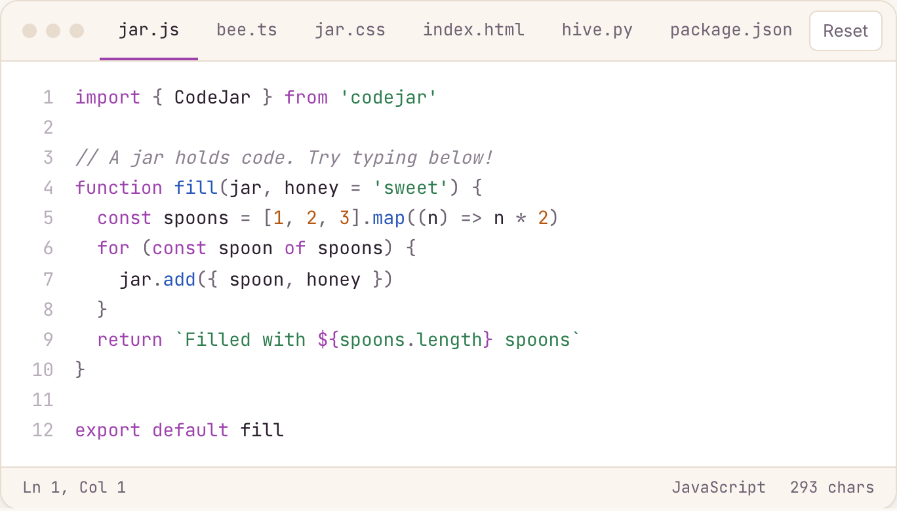

<p align="center"><a href="https://antonmedv.github.io/codejar/"></a></p>
<h3 align="center">CodeJar – an embeddable code editor for the browser</h3>

<p align="center">
  <a href="https://www.npmjs.com/package/codejar"></a>
  <a href="https://bundlephobia.com/package/codejar"></a>
  <a href="https://github.com/antonmedv/codejar/actions/workflows/test.yaml"></a>
</p>

<p align="center"><a href="https://antonmedv.github.io/codejar/"></a></p>

<p align="center"><b><a href="https://antonmedv.github.io/codejar/">Try the live demo →</a></b></p>

## Features

- **Tiny** — about 3 kB gzipped
- **No dependencies** — bring your own highlighter: [Prism.js](https://prismjs.com), [highlight.js](https://highlightjs.org), [Shiki](https://shiki.style), or a regex
- **Smart editing** — preserves indentation on new lines, adds closing brackets and quotes, wraps selections
- **Tab handling** — indent with <kbd>Tab</kbd>, outdent with <kbd>Shift</kbd>+<kbd>Tab</kbd>
- **Undo / redo** — history that restores both code and cursor position
- **TypeScript** — ships with type definitions

## Install

```sh
npm i codejar
```

Or import it straight from a CDN:

```html
<script type="module">
  import { CodeJar } from 'https://esm.sh/codejar'
</script>
```

## Usage

Create an element and pass it to `CodeJar` with a highlighting function:

```html
<div class="editor"></div>

<script type="module">
  import { CodeJar } from 'codejar'
  import Prism from 'prismjs'

  const highlight = (editor) => {
    editor.innerHTML = Prism.highlight(
      editor.textContent,
      Prism.languages.javascript,
      'javascript',
    )
  }

  const jar = CodeJar(document.querySelector('.editor'), highlight)
  jar.updateCode(`let foo = 'bar'`)
  jar.onUpdate((code) => console.log(code))
</script>
```

The highlight function receives the editor element and is expected to replace
its contents with highlighted HTML. It doesn't have to use a library:

```js
const highlight = (editor) => {
  editor.innerHTML = editor.textContent.replace(
    /\b(const|let|function|return)\b/g,
    '<span style="color: purple">$1</span>',
  )
}
```

<details>
<summary>Using highlight.js</summary>

```js
import hljs from 'highlight.js'

// The element needs a language class, e.g. <div class="editor language-js">,
// otherwise highlight.js auto-detects the language on every keystroke.
const highlight = (editor) => {
  // Remove the marker so highlight.js re-highlights on every change.
  delete editor.dataset.highlighted
  hljs.highlightElement(editor)
}
```

</details>

### Styling

CodeJar sets `white-space`, `overflow-wrap` and `contenteditable` for you. Add
a monospace font and anything else you like:

```css
.editor {
  font-family: ui-monospace, 'JetBrains Mono', monospace;
  font-size: 14px;
  line-height: 1.6;
  tab-size: 4; /* controls how wide a tab character renders */
  padding: 12px;
}
```

## Options

Pass options as the third argument:

```js
const jar = CodeJar(editor, highlight, {
  tab: ' '.repeat(4),
  indentOn: /[(\[]$/,
  autoclose: {
    open: `([{*`,
    close: `)]}*`,
  },
})
```

| Option          | Type            | Default                             | Description                                                                 |
| --------------- | --------------- | ----------------------------------- | --------------------------------------------------------------------------- |
| `tab`           | `string`        | `'\t'`                              | String inserted when <kbd>Tab</kbd> is pressed. Use CSS `tab-size` to size. |
| `indentOn`      | `RegExp`        | `/[({[]$/`                          | Increase indent on a new line when the text before the cursor matches.      |
| `moveToNewLine` | `RegExp`        | `/^[)}\]]/`                         | Move the text after the cursor to its own line when it matches.             |
| `spellcheck`    | `boolean`       | `false`                             | Enable the browser spellchecker.                                            |
| `catchTab`      | `boolean`       | `true`                              | Handle <kbd>Tab</kbd> / <kbd>Shift</kbd>+<kbd>Tab</kbd> for indentation.    |
| `preserveIdent` | `boolean`       | `true`                              | Keep the current indentation on a new line.                                 |
| `addClosing`    | `boolean`       | `true`                              | Automatically insert closing brackets and quotes.                           |
| `history`       | `boolean`       | `true`                              | Record undo / redo history.                                                 |
| `window`        | `Window`        | `window`                            | Window to use, e.g. when the editor lives in an iframe.                     |
| `autoclose`     | `{open, close}` | `{open: "([{'\"", close: ")]}'\""}` | Characters that trigger auto-closing and their matching closing characters. |

## API

`CodeJar(editor, highlight, options?)` returns an object with these methods:

#### `updateCode(code: string, callOnUpdate = true)`

Replaces the editor contents and re-highlights. Calls the `onUpdate` callback
unless `callOnUpdate` is `false`.

```js
jar.updateCode(`let foo = bar`)
```

#### `updateOptions(options: Partial<Options>)`

Changes options at runtime.

```js
jar.updateOptions({ tab: '\t' })
```

#### `onUpdate(callback: (code: string) => void)`

Sets a callback that is called whenever the code changes.

```js
jar.onUpdate((code) => {
  localStorage.setItem('code', code)
})
```

#### `toString(): string`

Returns the current code.

#### `save(): Position`

Returns the current cursor position or selection as `{ start, end, dir }`.

#### `restore(pos: Position)`

Restores a cursor position or selection returned by `save()`.

```js
const pos = jar.save()
jar.updateCode(format(jar.toString()), false)
jar.restore(pos)
```

#### `recordHistory()`

Pushes the current state onto the undo stack.

#### `destroy()`

Removes all event listeners from the editor.

### Types

```ts
import { CodeJar, type Options, type Position } from 'codejar'
```

## Related

- [react-codejar](https://github.com/guilhermelimak/react-codejar) — React wrapper for CodeJar
- [ngx-codejar](https://github.com/julianpoemp/ngx-codejar) — Angular wrapper for CodeJar
- [codejar-linenumbers](https://github.com/julianpoemp/codejar-linenumbers) — line numbers for CodeJar

## Development

```sh
npm ci
npm run dev        # demo page with hot reload
npm run build      # build the library into dist/
npm run build:demo # build the demo page into site/
npm run typecheck  # type-check with tsc
npm run lint       # lint with oxlint
npm run fmt        # format with oxfmt
```

See [RELEASE.md](RELEASE.md) for how releases are published.

## License

[MIT](LICENSE)
